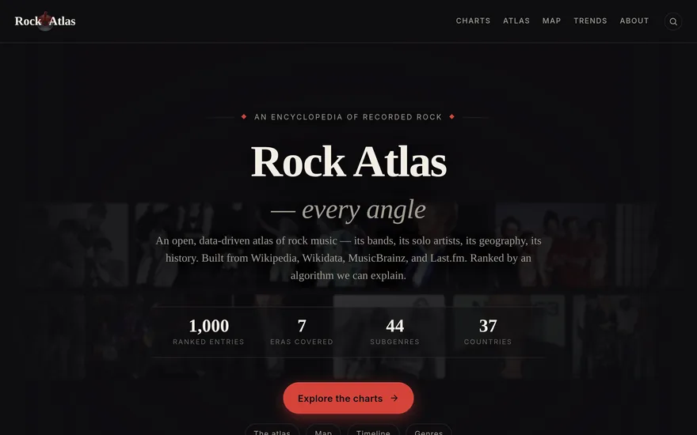
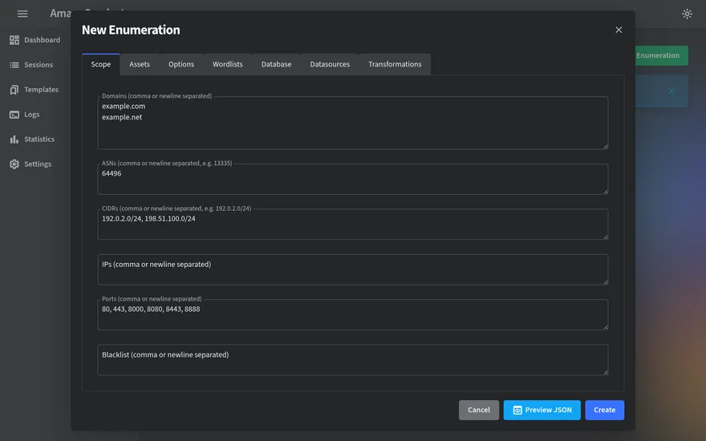
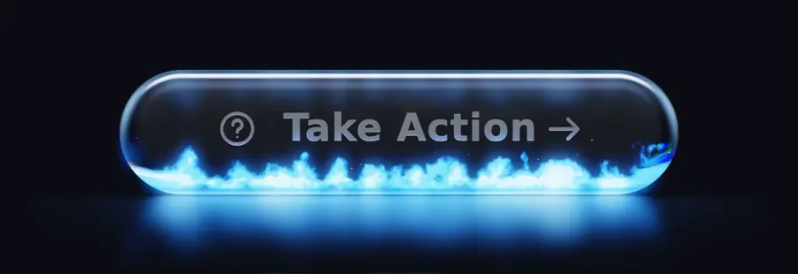
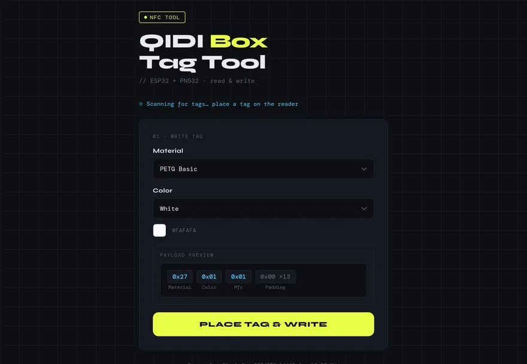

<p align="center">
  <a href="https://vic10.us"></a>
</p>

<p align="center">
  Quasi-polyglot, jack of all trades. Builds things with tech, but mostly tries to help others build their own.
</p>

<p align="center">
  <a href="https://vic10.us"><b>vic10.us</b></a> ·
  <a href="https://www.twitch.tv/vic10usx">twitch</a> ·
  <a href="https://www.youtube.com/vic10us">youtube</a> ·
  <a href="https://www.printables.com/@vic10us_3685972">printables</a> ·
  <a href="https://cults3d.com/en/users/vic10usx/3d-models">cults3d</a> ·
  <a href="https://www.instructables.com/member/vic10us/">instructables</a>
</p>

### `$ ls ~/projects --featured`

<table>
  <tr>
    <td width="46%"><a href="https://rock-atlas.com"></a></td>
    <td>
      <b><a href="https://rock-atlas.com">Rock Atlas</a></b><br>
      An open, data-driven encyclopedia of recorded rock: 1,000 ranked entries across eras, subgenres and countries, built from Wikipedia, Wikidata, MusicBrainz and Last.fm.<br>
      <sub><code>Astro</code> <code>data pipeline</code> <code>Wikidata</code></sub>
    </td>
  </tr>
  <tr>
    <td width="46%"><a href="https://github.com/vic10us/amass-conductor"></a></td>
    <td>
      <b><a href="https://github.com/vic10us/amass-conductor">amass-conductor</a></b><br>
      Kubernetes-native control panel for coordinating distributed Amass enumeration engines. Launch, monitor and manage recon jobs at scale.<br>
      <sub><code>Kubernetes</code> <code>.NET</code> <code>security</code></sub>
    </td>
  </tr>
  <tr>
    <td width="46%"><a href="https://vic10us.github.io/glass-button/"></a></td>
    <td>
      <b><a href="https://github.com/vic10us/glass-button">glass-button</a></b><br>
      Framework-agnostic web component: a thick, dark glass pill with real-time WebGL2 fire or water living inside it. Zero dependencies.<br>
      <sub><code>npm i @vic10us/glass-button</code> · <a href="https://vic10us.github.io/glass-button/">playground</a></sub>
    </td>
  </tr>
  <tr>
    <td width="46%"><a href="https://github.com/vic10us/QiDiBoxRFID"></a></td>
    <td>
      <b><a href="https://github.com/vic10us/QiDiBoxRFID">QiDiBoxRFID</a></b><br>
      Open-source NFC tag manager for the QidiBox filament system, combining embedded firmware with a small web app.<br>
      <sub><code>C</code> <code>embedded</code> <code>NFC</code></sub>
    </td>
  </tr>
</table>

<sub>also: <a href="https://github.com/vic10us/Stealthburner_CR10_Assembly">Stealthburner for CR-10 / Ender 3</a> ·
<a href="https://github.com/vic10us/StreamerBotCodeExamples">Streamer.bot examples</a> ·
<a href="https://github.com/vic10us/OBS.WebSockets.Core">OBS.WebSockets.Core</a> ·
<a href="https://github.com/vic10us/website">the site itself</a></sub>

### `$ cat ~/stats`

<p>
  
  
</p>

<details>
<summary><code>$ ls -a</code></summary>
<br>

```
.  ..  .plan  .white-rabbit  .hangar/
```

some doors only open on [vic10.us](https://vic10.us). try the backtick key.

</details>

<p align="center"><sub><i>be kind to yourself and all those around you</i> · he/him</sub></p>
